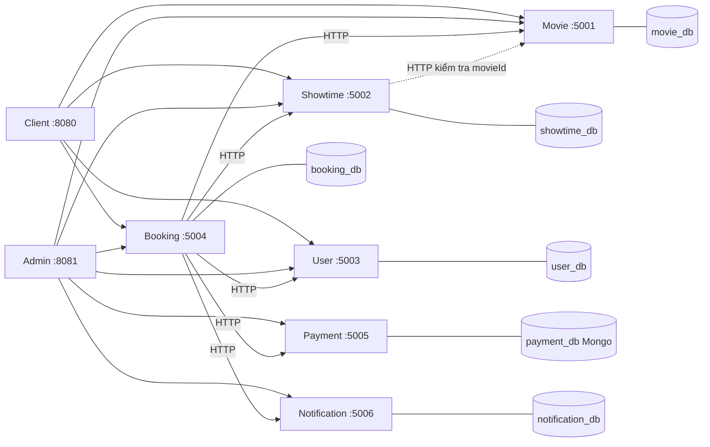

# ARCHITECTURE — Kiến trúc hướng dịch vụ (SOA) hệ thống đặt vé phim

## 1. Sáu service độc lập — không phải một ứng dụng

| Service | Cổng | Công nghệ giữa kỳ (code thuần) | CSDL | Trách nhiệm duy nhất |
|---|---|---|---|---|
| Movie | 5001 | Python `http.server` + PyMySQL | `movie_db` | Danh mục phim |
| Showtime | 5002 | PHP 8.1+ thuần + PDO | `showtime_db` | Suất chiếu, giá vé |
| User | 5003 | Java 17 `HttpServer` + JDBC + jBCrypt | `user_db` | Tài khoản, đăng nhập |
| Booking | 5004 | C# .NET 8 `HttpListener` + ADO.NET | `booking_db` | Đơn đặt vé, **điều phối** |
| Payment | 5005 | Node.js `http` + MongoDB | `payment_db` | Giao dịch thanh toán |
| Notification | 5006 | Go `net/http` + `database/sql` | `notification_db` | Gửi và ghi nhật ký thông báo |

Sáu ngôn ngữ khác nhau là **có chủ đích**: chứng minh các service chỉ phụ thuộc vào hợp đồng HTTP/JSON, không phụ thuộc cài đặt bên trong.

## 2. Các nguyên tắc bắt buộc

1. **Mỗi service là một tiến trình riêng**, có cổng riêng, chạy và dừng độc lập. Tắt một service không được làm sập service khác.
2. **Database-per-service** (xem `DATABASE_CONTRACT.md`). Không có truy vấn JOIN hay khóa ngoại xuyên service.
3. **Giao tiếp chỉ qua HTTP + JSON** theo `API_CONTRACT.md`. Không import code của nhau, không dùng chung thư viện nghiệp vụ, không đọc file của nhau.
4. **Booking là orchestrator** của luồng đặt vé; các service còn lại không gọi ngược Booking.
5. **Chịu lỗi**: mọi lời gọi liên service có timeout và có hành vi rõ ràng khi đối tác sập (xem `INTEGRATION_FLOW.md`).
6. **Giao diện dùng chung một khung**: Admin dùng `admin/css/admin.css` + `admin/js/common.js` cho cả 6 trang. Client là ứng dụng riêng (`client/`).
7. **Cấu hình qua biến môi trường** (`.env`), không hard-code địa chỉ, mật khẩu.

## 3. Admin và Client
- **Admin** (`admin/`, cổng 8081): HTML/CSS/JS tĩnh. Mỗi trang trong `admin/pages/` chỉ khai báo cột và form; khung, bảng, hộp thoại, gọi API, thông báo lỗi nằm ở `common.js`.
  Địa chỉ service nằm ở **một** chỗ: `admin/js/config.js`.
- **Client** (`client/`, cổng 8080): đăng nhập/đăng ký → danh sách phim → suất chiếu → chọn ghế → đặt vé → kết quả → vé của tôi. Chỉ gọi Movie, Showtime, User, Booking.

## 4. Lộ trình giữa kỳ → cuối kỳ
Giữ nguyên hợp đồng API; chỉ thay cách cài đặt bên trong:
Movie → Django · Showtime → CodeIgniter 4 · User → Spring Boot + JWT · Booking → ASP.NET Core · Payment → Express/NestJS · Notification → Gin/Fiber.
Vì client và các service khác chỉ biết hợp đồng, việc chuyển framework không ảnh hưởng phần còn lại.
