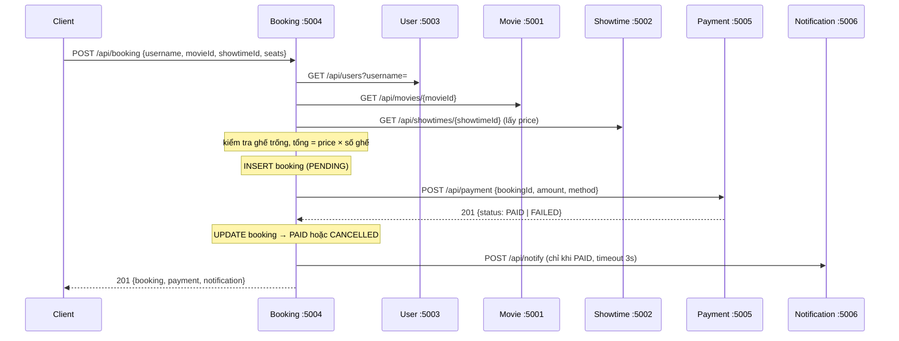

# INTEGRATION_FLOW — Luồng đặt vé và xử lý lỗi

## 1. Luồng đặt vé thành công

Booking là **orchestrator duy nhất**. Client, Admin không tự gọi Payment/Notification để "đặt vé".

## 2. Bảng xử lý lỗi (đã kiểm thử bằng `tests/integration/run_tests.py`)

| Tình huống | Booking làm gì | Client nhận |
|---|---|---|
| Body sai / ghế sai định dạng | Từ chối trước khi gọi ai | 400 `VALIDATION_ERROR` |
| User không tồn tại | Dừng, chưa lưu gì | 404 `USER_NOT_FOUND` |
| Movie/Showtime không tồn tại, suất không thuộc phim | Dừng, chưa lưu gì | 404 `MOVIE_NOT_FOUND` / `SHOWTIME_NOT_FOUND`, hoặc 400 |
| Ghế đã có người đặt | Dừng, chưa lưu gì | 409 `SEAT_TAKEN` |
| **User / Movie / Showtime sập** | Dừng, chưa lưu gì | 503 `*_SERVICE_UNAVAILABLE` |
| Payment trả `FAILED` | Đơn → `CANCELLED` (nhả ghế), **không** gọi Notification | 201, `status: CANCELLED`, `payment.status: FAILED` |
| **Payment sập / quá 5 giây** | Hỏi lại `GET /api/payment?bookingId=` (phòng khi đã ghi giao dịch); không có → đơn → `CANCELLED` | 503 `PAYMENT_SERVICE_UNAVAILABLE` |
| **Notification sập** | Đơn **vẫn PAID** (thông báo chỉ là phụ) | 201, `notification: FAILED` |
| Gọi thanh toán lại cho đơn đã PAID | Payment từ chối | 409 `ALREADY_PAID` |

Mọi lời gọi giữa service có **timeout** (mặc định 5 giây; Notification 3 giây) để một service chậm không làm treo cả hệ thống.

## 3. Giới hạn đã biết (ghi rõ để bảo vệ trước thầy)
- Không có giao dịch phân tán (2-phase commit). Thay vào đó dùng **trạng thái + bù trừ** (PENDING → PAID/CANCELLED), kiểu Saga đơn giản.
- Nếu Payment đã ghi `PAID` nhưng cả phản hồi lẫn lần hỏi lại đều mất, đơn bị hủy trong khi giao dịch vẫn PAID → cần đối soát thủ công. Cải tiến cuối kỳ: job đối soát định kỳ hoặc hàng đợi tin nhắn.
- Chống đặt trùng ghế dùng khóa trong tiến trình Booking (một instance). Chạy nhiều instance cần ràng buộc UNIQUE hoặc khóa trong CSDL.
- Giữa kỳ `username` lấy từ body; cuối kỳ lấy từ JWT.
