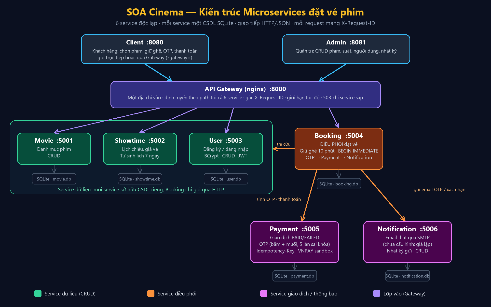

# 🎬 SOA — Hệ thống đặt vé phim (SOA Cinema)

Đồ án môn **Kiến trúc hướng dịch vụ (SOA)**. Hệ thống gồm **6 microservice độc lập** viết bằng Python (FastAPI + SQLite, mỗi service một CSDL riêng), giao tiếp với nhau **chỉ bằng HTTP + JSON**, cùng **API Gateway (Nginx)** tùy chọn, giao diện **Admin** và **Client**.
Đây **không phải** một ứng dụng nguyên khối: tắt một service, các service còn lại vẫn chạy.

| Service | Cổng | Công nghệ | CSDL | Thư mục |
|---|---:|---|---|---|
| Movie | 5001 | Python / FastAPI | `movie.db` (SQLite) | [`services-py/movie`](services-py/movie) |
| Showtime | 5002 | Python / FastAPI | `showtime.db` (SQLite) | [`services-py/showtime`](services-py/showtime) |
| User | 5003 | Python / FastAPI | `user.db` (SQLite) | [`services-py/user`](services-py/user) |
| Booking | 5004 | Python / FastAPI | `booking.db` (SQLite) | [`services-py/booking`](services-py/booking) |
| Payment | 5005 | Python / FastAPI | `payment.db` (SQLite) | [`services-py/payment`](services-py/payment) |
| Notification | 5006 | Python / FastAPI | `notification.db` (SQLite) | [`services-py/notification`](services-py/notification) |
| API Gateway *(tùy chọn)* | 8000 | Nginx | — | [`services-py/gateway`](services-py/gateway) |
| Admin | 8081 | HTML / CSS / JS (Bootstrap) | — | [`admin`](admin) |
| Client | 8080 | HTML / CSS / JS (Bootstrap) | — | [`client`](client) |

## Kiến trúc tổng quan


Client/Admin → (API Gateway tùy chọn) → 6 service độc lập, mỗi service một CSDL SQLite; **Booking điều phối** User/Movie/Showtime (tra cứu), Payment (giao dịch + OTP) và Notification (email OTP/xác nhận). Mỗi request mang `X-Request-ID` xuyên suốt log của mọi service. CI tự chạy test cho từng service và bộ kiểm thử tích hợp trên mỗi Pull Request (`.github/workflows/ci.yml`).

## Đọc theo thứ tự này
1. [`ARCHITECTURE.md`](ARCHITECTURE.md) — kiến trúc và nguyên tắc bắt buộc
2. [`API_CONTRACT.md`](API_CONTRACT.md) — **hợp đồng API chung** (mọi người phải theo)
3. [`DATABASE_CONTRACT.md`](DATABASE_CONTRACT.md) — mỗi service một CSDL, seed dùng chung
4. [`INTEGRATION_FLOW.md`](INTEGRATION_FLOW.md) — luồng đặt vé, xử lý khi service sập
5. [`TEAM_RULES.md`](TEAM_RULES.md) — ai sửa gì, quy trình Git
6. [`INTEGRATION_CHECKLIST.md`](INTEGRATION_CHECKLIST.md) — kiểm tra trước khi gộp/demo · [`CHANGELOG.md`](CHANGELOG.md)

## Hướng dẫn chạy chương trình

### Cách 1: Chạy trực tiếp trên máy (Local, không cần Docker)
**Yêu cầu:** Python **3.12** có sẵn trong `PATH`. Các service tự lưu dữ liệu vào SQLite (`services-py/<tên>/data/<tên>.db`), không cần cài MySQL hay MongoDB.

```bash
# Windows                                    # Linux / macOS / Git Bash
scripts\init-db.bat                          bash scripts/init-db.sh      # (tùy chọn) tạo & nạp dữ liệu mẫu; start-all tự tạo lần đầu
scripts\start-all.bat                        bash scripts/start-all.sh    # chạy 6 service (5001–5006) + Admin (8081) + Client (8080)
scripts\stop-all.bat                         bash scripts/stop-all.sh     # dừng toàn bộ tiến trình
python ui-seed/seed-movies.py                                             # (tùy chọn) nạp thêm phim (5 -> 15 phim) + suất chiếu 7 ngày tới
```

- Lần chạy đầu tiên, mỗi service tự tạo `.venv/` riêng và cài thư viện từ `requirements.txt` nên mất khoảng 1 phút.
- Mở **Client:** http://localhost:8080 | **Admin:** http://localhost:8081 | **Swagger UI:** `http://localhost:500x/docs`.
- **Chạy lẻ một service** (ví dụ Booking): `scripts\run-service.bat booking` (Windows) hoặc `bash scripts/run-service.sh booking` (Linux/macOS).
- **Trùng cổng trên Windows (`WinError 10013`):** đặt biến môi trường `SOA_PORT_OFFSET=10000` trước khi chạy `scripts\start-all.bat` để dịch toàn bộ cổng sang `15001–15006`.
- Nếu đang chạy Docker Compose (`services-py/docker-compose.yml`), hãy `docker compose down` hoặc `stop` trước vì dùng chung cổng `5001–5006`, `8080`, `8081`.

### Cách 2: Chạy toàn hệ thống bằng Docker Compose
**Yêu cầu:** Docker Desktop / Docker Engine + Docker Compose v2.

```bash
cd services-py
cp .env.example .env        # tùy chọn: chỉnh cổng host, JWT_SECRET, VNPAY_*, SMTP_*
docker compose config       # kiểm tra cú pháp cấu hình
docker compose up --build   # build & chạy 6 service + Gateway (:8000) + Client (:8080) + Admin (:8081)
docker compose logs -f      # theo dõi log (Ctrl+C để thoát xem log)
docker compose down         # dừng container (giữ lại volume dữ liệu SQLite)
```

- Khi dùng Gateway, có thể truy cập Client/Admin kèm `?gateway=http://localhost:8000`.

### Cấu hình biến môi trường (tùy chọn)
Hệ thống **chạy được ngay với cấu hình mặc định** (chế độ demo: thanh toán giả lập, thông báo `SIMULATED`, token demo). Chỉ cần tạo/sửa file `.env` (dựa theo `services-py/.env.example` cho Docker hoặc `services-py/<tên>/.env.example` cho chạy local) khi muốn bật thêm tính năng:
- **Xác thực JWT thật (`JWT_SECRET`, `JWT_REQUIRED`):** điền cùng một chuỗi `JWT_SECRET` (≥ 32 ký tự) cho User và Booking; đặt `JWT_REQUIRED=true` ở Booking nếu muốn ép buộc Bearer token.
- **Gửi email OTP/xác nhận thật (`SMTP_HOST`, `SMTP_PORT`, `SMTP_USER`, `SMTP_PASSWORD`, `SMTP_FROM`):** cấu hình trong `services-py/notification/.env` (hoặc `services-py/.env` với Docker).
- **Thanh toán VNPAY Sandbox (`VNPAY_TMN_CODE`, `VNPAY_HASH_SECRET`, `VNPAY_URL`, `VNPAY_RETURN_URL`):** cấu hình trong `services-py/payment/.env` (hoặc `services-py/.env` với Docker).
- **OTP thanh toán (`OTP_REQUIRED`, `OTP_DEBUG`):** mặc định `OTP_REQUIRED=true` trên Booking/Payment khi chạy Docker/Compose (hoặc đặt trong `.env` từng service khi chạy local).

### Kiểm thử hệ thống
```bash
# 1) Unit & API test của từng service (6 service)
cd services-py/<tên> && python -m pytest -q

# 2) Kiểm thử tích hợp 6 service đang chạy
python tests/integration/run_tests.py
# Tùy chọn cấu hình địa chỉ / dải cổng / Gateway:
#   SOA_HOST=127.0.0.1 SOA_PORT_OFFSET=11000 python tests/integration/run_tests.py
#   SOA_GATEWAY_URL=http://localhost:8000 python tests/integration/run_tests.py

# 3) Demo chịu lỗi (tắt 1 service rồi chạy, vd payment/notification/showtime/movie/user):
python tests/integration/run_tests.py --expect-down payment

# 4) Bộ pytest + httpx E2E (CHỈ chạy trên môi trường cô lập vì tạo đơn thật; tự skip nếu chưa bật stack):
SOA_PORT_OFFSET=11000 python -m pytest -q tests/integration/test_e2e.py
```

**Tài khoản đăng nhập thử** (dữ liệu mẫu của User Service):

| Vai trò | Tên đăng nhập | Mật khẩu |
|---|---|---|
| Khách (Client) | `user1` | `User@123` |
| Khách (Client) | `user2` | `User@123` |
| Quản trị (Admin) | `admin` | `Admin@123` |

## Cấu trúc thư mục
```
services-py/      6 microservice Python (+ gateway/, docs/, docker-compose.yml, .env.example)
database/         schema.sql + seed.sql tham chiếu gốc
admin/            giao diện quản trị (Bootstrap, html/css/js, assets)
client/           giao diện đặt vé người dùng (Bootstrap, html/css/js, assets)
ui-seed/          script nạp 10 phim mới & suất chiếu qua HTTP API
tests/integration bộ kiểm thử tích hợp & E2E (run_tests.py, test_e2e.py)
docs/             ERD, Use Case, DFD, báo cáo của từng thành viên
scripts/          init-db, start-all, stop-all, run-service (.bat/.sh)
```

## Nạp thêm dữ liệu & tài nguyên (UI Seed)
Để làm phong phú danh mục phim cho giao diện người dùng (từ 5 phim gốc lên 15 phim đa dạng thể loại cùng suất chiếu 7 ngày tới):
```bash
# Đảm bảo Movie Service (cổng 5001) và Showtime Service (cổng 5002) đang chạy
python ui-seed/seed-movies.py
```
*Script có tính lũy thừa (idempotent), chạy lặp lại an toàn không sinh phim hay suất chiếu trùng lặp.*

## Nguồn poster & trailer
Toàn bộ dữ liệu hình ảnh và video trailer đều được xác thực từ các nguồn công khai chính thức:
- **Poster phim**: Khai thác từ [The Movie Database (TMDB)](https://www.themoviedb.org/) và [Wikimedia Commons](https://commons.wikimedia.org/). Ảnh được tải về cục bộ tại `client/assets/posters/` (tỉ lệ 2:3) và `client/assets/backdrops/` (hero banner) để hệ thống hoạt động hoàn toàn offline.
- **Trailer YouTube**: Sử dụng mã nhúng video chính thức từ các kênh phân phối của hãng phim (Marvel Entertainment, Warner Bros. Pictures, Universal Pictures, Pixar, Sony Pictures, Illumination, Ly Hai Production, Trấn Thành Town, Galaxy Cinema, CJ ENM Vietnam, NEON, Well Go USA). Đã xác thực thành công qua YouTube oEmbed API.
- **Metadata mở rộng**: Quản lý độc lập tại `client/js/movie-extras.js` (không can thiệp CSDL backend của Movie Service), cung cấp nhãn tuổi (P, T13, T16, T18), thể loại chi tiết, tóm tắt tiếng Việt và liên kết trailer.

## Tạo repository GitHub
Tạo repo **rỗng**, rồi nhóm trưởng chạy một lần: `bash scripts/setup-git.sh https://github.com/<tài-khoản>/soa-datve.git`
(tạo `main`, `develop` và 6 nhánh `feature/tvN-*`). Sau đó bật bảo vệ nhánh `main`/`develop` (bắt buộc Pull Request).

